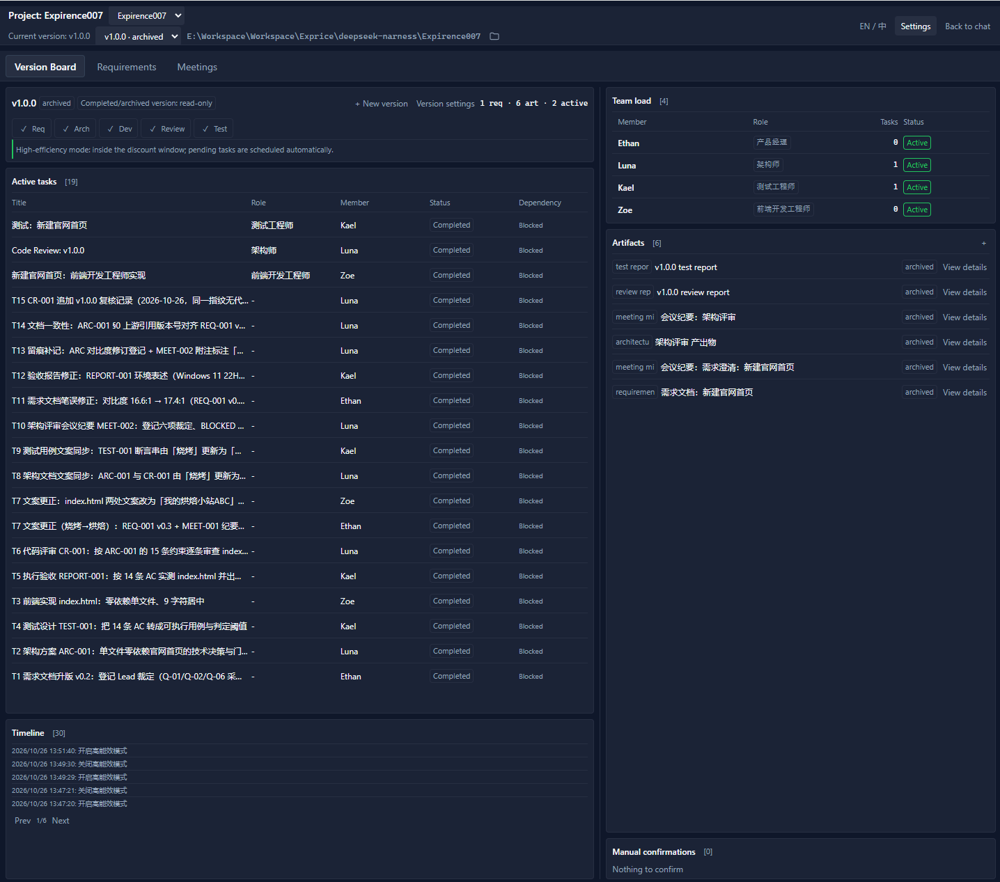
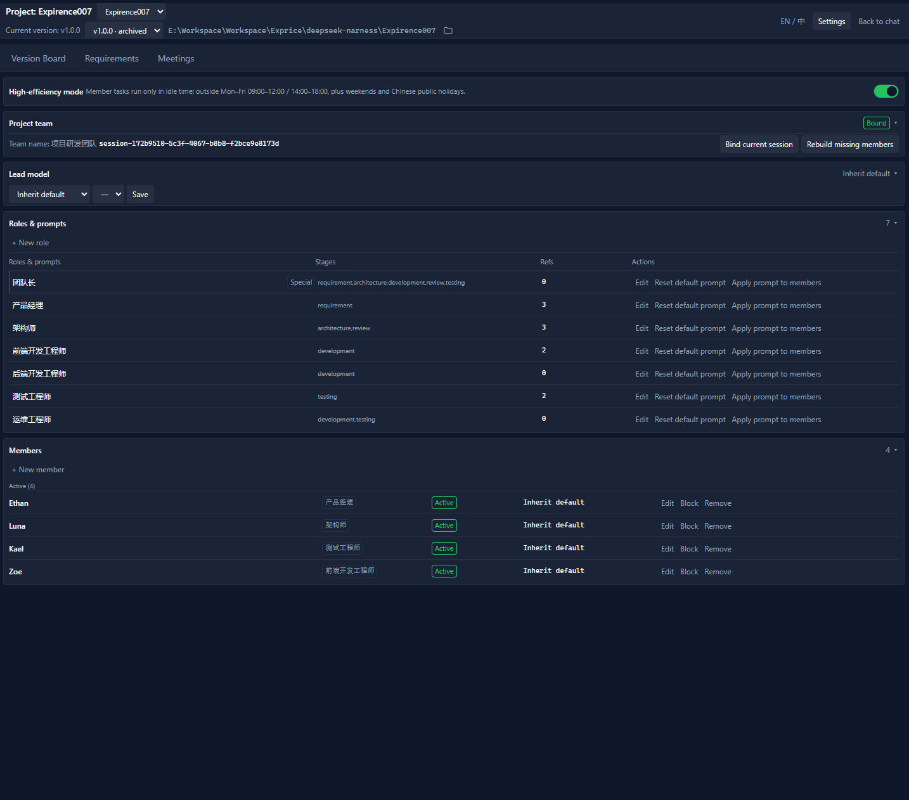
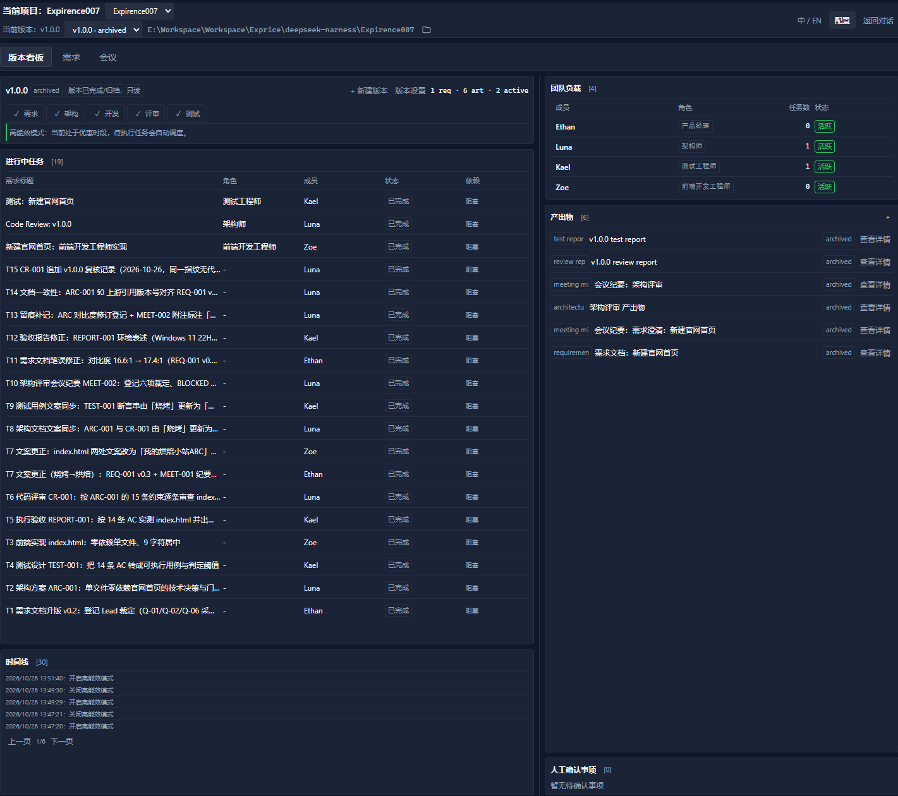
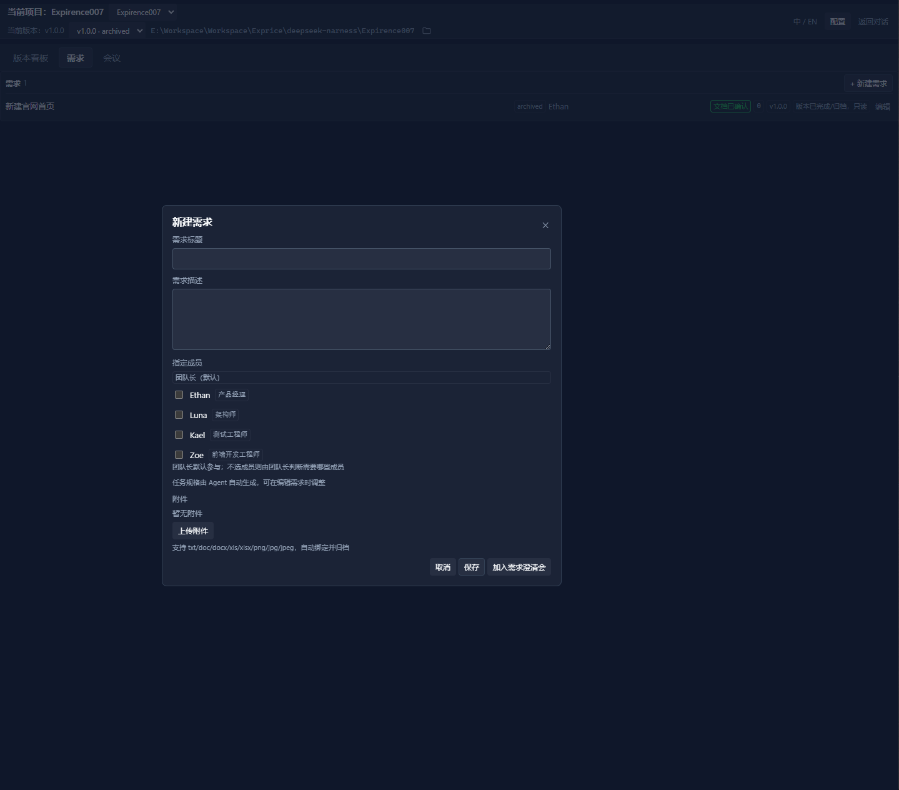
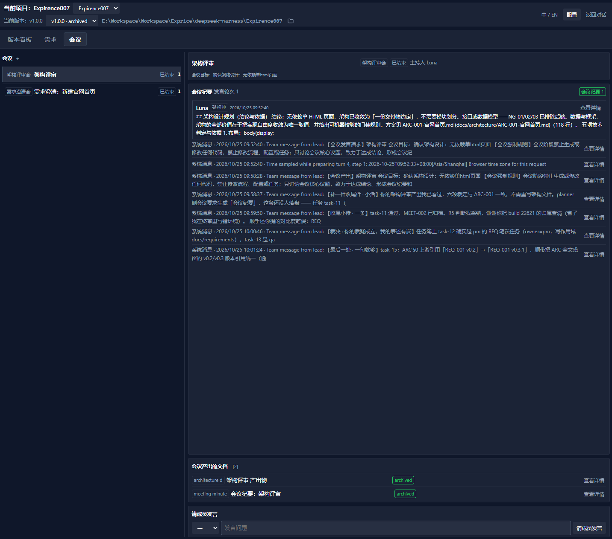
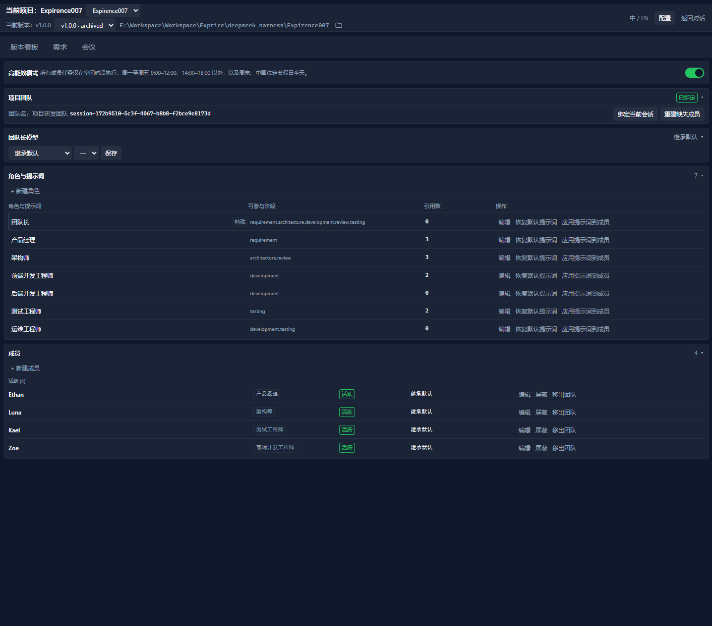

# DSH Agent Team Planner

[English](README.md) | 中文

[](https://github.com/deepseek-ai)
[](https://nodejs.org)
[](LICENSE)
[](#免责声明)

**为 [DeepSeek Harness](https://github.com/deepseek-ai) Agent Teams 增加的一层项目研发工作台。**

Agent Teams 提供了「团队」和「任务板」这两组协作原语。Agent Team Planner 补上它们上面的那一层：**需求、版本、阶段门禁、会议、文档、人工确认和调度**，让一组 Agent 像一个小型交付团队，而不是一个聊天室。

> 一个工作区 = 一个项目团队。一个版本 = 一条交付流水线。一次点击 = 下一个合法动作。








## 为什么需要它

Agent Teams 擅长**协作原语**：创建成员、派发任务、等待、完成。但它有意不决定：需求是什么、什么时候可以进入下一阶段、哪份文档才是事实来源。

这个插件把这些决定变成可见、可审计的流程：

| 没有 Planner | 有 Planner |
|---|---|
| 任务从对话里临时产生 | 需求进入版本，门禁满足后才开闸 |
| 「架构做完了吗」散落在聊天里 | 架构文档是产出物，确认后才推进阶段 |
| 成员只是临时名字 | 可复用角色、每成员模型路由、显示名 |
| 会议纪要不知道放哪 | 会议产出直接成为版本关联文档 |
| 低峰/夜间工作需要人手计时 | 高能效模式在 DeepSeek 空闲时段自动调度 |

这是一个**社区插件**，只使用公开 Host 服务和官方 Agent Teams API，不 fork、不修改、不绕过 DSH。

## 功能导览

### 1. 一个工作台，而不是又一个聊天标签

左侧入口 `dsh-agent-team-planner` 打开完整主区工作台，包含三个 Tab：

- **版本看板**：版本头、五阶段流水线、进行中任务、时间线、团队负载、产出物、人工确认事项。
- **需求**：独立需求工作区，支持新建、编辑、附件、指定成员、绑定版本。
- **会议**：按版本组织的需求澄清会、架构评审会、测试评审会和自定义会议。

顶栏集中展示：当前项目、工作区切换、当前版本、版本切换、打开工作区目录、中英文切换、配置、返回对话。

布局刻意保持高密度：主/侧 60/40、列内滚动、自适应分页、页面不整体滚动。

### 2. 需求与真实附件

- 新建需求可填写标题、描述，并**多选成员**。
- 团队长默认参与；被选中的成员优先成为任务执行人。
- 支持多附件上传：`txt / doc / docx / xls / xlsx / png / jpg / jpeg`，单文件 ≤ 10MB。
- 附件保存在工作区状态目录中，在需求弹窗内可**打开**和**删除**。
- 需求文档是产出物，不是藏在提示词里的文本。

### 3. 版本、门禁与任务派发

版本阶段：

```text
需求 -> 架构 -> 开发 -> 评审 -> 测试 -> 完成
```

- 需求阶段：需求文档确认后才能进入架构。
- 架构阶段：架构设计文档确认后才能开始开发。
- 开发阶段：生成/编辑任务规格，派发为官方 Agent Teams 任务。
- 评审/测试：完成后创建评审/测试任务；报告确认后推进版本。
- 已完成/已归档版本**只读**：需求、产出物、采集、会议都不能再改。

任务规格可以由本地确定性拆分器生成（优先使用需求中指定的开发成员，否则根据架构文档/需求文本推断），也可以手工编辑 JSON。拆分不会调用团队长对话，因此团队长忙碌时也能用。

### 4. 成员：先配置，首次使用时才初始化

- 新项目提供六个默认配置：Luna（产品）、Kael（架构）、Zoe（前端）、Owen（后端）、Mia（测试）、Jasper（运维）。
- `member.create` 只写**成员配置**，不创建官方成员、不启动对话、不执行任务。
- 官方 teammate 在首次派发或首次参会时才懒创建；如果官方已有同名成员则直接复用，避免重名。
- 每成员可配置单独模型路由：provider / model / reasoning effort。
- 屏蔽成员会停止派发；移出成员保留官方记录，但退出项目名册。
- UI 中所有成员相关位置显示**显示名**，而非内部成员名。

### 5. 会议产出真正的版本文档

- **需求澄清会**：讨论后生成的需求文档会立即成为版本关联的需求文档草稿，出现在版本看板；保存需求时复用该文档，不再生成不可见副本。
- **架构评审会**：进入架构设计时自动创建并开始，产品经理和架构师参会；架构师按专用模板产出架构设计文档，确认后自动归档。
- 会议页支持：参会成员勾选、主持人选择、发言进度、产出文档入口、发言分页、Markdown 渲染查看。
- 会议期间提示词加入强制规则：不生成/修改代码，不修改流程/配置/任务，只讨论会议议题并形成结论、纪要和要求的文件。
- 非参会成员会收到「会议进行中，不要开始新工作」提示；会议期间不会给他们派发新任务。

### 6. 人工确认，而不是默认假设

产出物下方有 **「人工确认事项」**：

- 开发完成确认：逐条列出任务、负责人、状态和相关产物。
- 一键「确认并进入评审」。
- **确认不通过**：必须填写原因；原因会写入版本、显示在待确认项上，并发送给开发成员。
- 草稿评审/测试报告可打开查看渲染后的 Markdown，并确认。

确认评审/测试报告后，不再依赖任务绑定状态：文档确认本身就能推进阶段。

### 7. 高能效模式（DeepSeek 空闲时段）

配置页有真正的开关 **高能效模式**（默认关闭）。开启后：

- 新的成员任务派发和产出物采集只在 DeepSeek **空闲时段**执行。
- 高峰时段（北京时间，周一至周五，不含中国法定节假日）：`09:00–12:00`、`14:00–18:00`。
- 周末、中国法定节假日（内置 2026 年安排）和其余所有时间均为空闲时段。
- 正在执行的任务继续，不会被中断；待执行任务挂起。
- 进入空闲时段后，状态轮询会自动继续任务泵。
- 版本看板显示当前是「等待中」还是「可调度」。

### 8. 文档就是文档

- 所有产出物都有 **查看详情**，弹窗按 Markdown 渲染。
- 草稿产出物额外保留 **编辑**；编辑时仍显示原始文本，这是有意设计。
- 会议发言和系统消息显示摘要，详情按渲染结果查看，不再直接铺 Markdown 源码。
- 产出物与版本关联；需求文档、架构文档、会议纪要都留在看板上。

### 9. 持久化与恢复

- Planner 状态按**工作区**隔离，不依赖 UI 当前选中了哪个会话；返回对话后重新进入，数据仍在。
- 写入串行化、原子替换（唯一临时文件 + fsync + rename 重试）并做 revision CAS。
- 备份轮转保留最近 10 份**含数据**的快照，空快照不会挤掉真实数据。
- 区分文件损坏/缺失与 Windows 瞬时占用；可从含数据备份恢复。
- DSH 重启后官方任务板变冷时，任务列表和时间线会回退到持久化的 bindings。

### 10. 双语、无障碍、深色优先

- 中文 / English / Русский 三语 UI；默认跟随 DSH 语言，不支持的语言回退英文。
- 深色开发者工具配色、4/8px 栅格、语义化状态色。
- 焦点环、`role` / `switch` / `aria-checked`、Esc 关闭弹窗、减少动效样式。
- 任务、产出物、成员、时间线均支持自适应条数与分页。

## 环境要求

- **DeepSeek Harness 0.2.1-rc.2** 或兼容的 0.2.x 版本，并启用官方 **Agent Teams** profile。
- **Node.js 20+**。
- Windows、macOS 或 Linux。手动安装脚本是 PowerShell；插件本体是 Node.js。

## 安装（仅 GitHub，不发 npm）

本项目只通过 GitHub 分发，没有 npm 包。

```powershell
git clone https://github.com/haistar/dsh-agent-team-planner.git
cd dsh-agent-team-planner

# 将插件链接进 web profile，并注册 bundle
powershell -NoProfile -ExecutionPolicy Bypass -File .\scripts\install-manual.ps1

# 重启 DSH Web
```

安装脚本会备份 profile manifest、添加 `link:` 依赖、注册 bundle，并复制发布文件。卸载：

```powershell
powershell -NoProfile -ExecutionPolicy Bypass -File .\scripts\uninstall-manual.ps1
```

## 快速开始

1. 打开工作区，在「配置 → 团队」绑定 Team Session。
2. 新建版本。
3. 添加需求，指定成员并上传附件。
4. 开需求澄清会，生成并确认需求文档。
5. 进入架构设计——架构评审会自动创建并打开。
6. 生成并确认架构设计文档。
7. 开始开发，任务规格会派发给指定开发成员。
8. 开发完成后，在「人工确认事项 → 确认并进入评审」。
9. 确认评审/测试报告，版本完成并归档产出物。

## 仓库结构

```text
lib/
  index.js          Host 端：状态、角色/成员、需求、版本、门禁、会议、路由、调度
  client.js         Client 端：侧栏入口、工作台、弹窗、i18n、Markdown 查看器
  roles.js          七个内置角色提示词
cordis.patch.yml    DSH bundle 注册
scripts/            DSH web profile 的手动安装/卸载脚本
test/               Host 冒烟、Client 模拟、Renderer/i18n 检查
docs/               设计系统与工作台 mockup
```

## 开发

```powershell
npm run check   # 语法检查
npm test        # Host 冒烟 + Client 模拟 + Renderer/i18n
```

测试使用内存中的假 Host，不需要真实团队、网络或 DSH 实例。CI 在 GitHub Actions 上运行同一套测试。

## 配置参考

| 区域 | 行为 |
|---|---|
| 团队 | 一个工作区绑定一个 Team Session；可重绑、重建缺失成员 |
| 角色 | 7 个内置角色 + 自定义角色；提示词可编辑；未覆盖的成员跟随角色提示词 |
| 成员 | 显示名、角色、模型路由、屏蔽、逻辑移出、首次使用时创建 |
| 需求 | 多附件、指定成员、任务规格编辑、版本绑定 |
| 会议 | 需求澄清、架构评审、测试评审、自定义；参会成员勾选 |
| 高能效 | 开关 + 空闲时段门控；内置 2026 中国法定节假日 |
| 状态 | 工作区 `.dsh_teams/planner/state.json`，备份在同目录 |

## 常见问题

- **插件入口不见了** — 安装后重启 DSH Web；确认 profile bundle 列表包含 `dsh-agent-team-planner`。
- **session/agent-busy** — 插件会优先使用根会话，并解析子会话的父会话；从旧版本升级后请刷新。
- **重启后任务/时间线空了** — 任务会回退到持久化 bindings，时间线回退到 binding 历史；若整个工作台为空，检查工作区路径与 `.dsh_teams/planner/` 状态文件。
- **高能效模式一直等待** — 北京时间周一至周五 `09:00–12:00 / 14:00–18:00` 为高峰，任务会挂起；周末和法定节假日全天可调度。
- **会议结束仍显示进行中** — 先结束会议；Dock 和提示词只认 `active` 且 `closedAt === null` 的会议。

## 安全与隐私

- Planner 不做遥测、不上报分析数据、不调用外部服务。
- 所有规划数据和附件保存在工作区 `.dsh_teams/planner/` 下。
- 插件不保存凭据；模型路由只记录 provider/model 标识。
- Agent 执行仍由 DSH 和官方 Agent Teams runtime 负责。

## 已知限制

- 基于 DSH `0.2.1-rc.2` 构建和测试；未来 DSH 版本可能改变 Host/Client 接口。
- 仅 GitHub 分发，不发布 npm。
- 中国法定节假日表当前覆盖 2026 年，后续年份需要年度更新。
- 官方任务视图不提供 Token 统计；任务详情会明确说明，而不是编造数字。
- 对话中临时提出的自定义确认尚未自动结构化；人工确认区目前由开发完成和草稿报告推导。

## 升级

本项目仅通过 GitHub 分发，没有 npm 包，也没有自动更新器。升级流程：`git pull --ff-only` → 重新运行 `scripts/install-manual.ps1` → 重启 DSH Web。回滚、自定义 profile 和状态说明见 [UPGRADING.md](UPGRADING.md)。

## 贡献

欢迎 Issue 和 PR。提交前请运行 `npm run check` 与 `npm test`，保持改动范围清晰，并在 PR 中注明手动验证所用的 DSH 版本。详见 [CONTRIBUTING.md](CONTRIBUTING.md)。

## 许可证

MIT，详见 [LICENSE](LICENSE)。

## 免责声明

这是 **haistar (Hohhabur)** 维护的独立社区项目，与 DeepSeek 无隶属、背书或支持关系。「DeepSeek」「DeepSeek Harness」仅用于说明兼容性。
